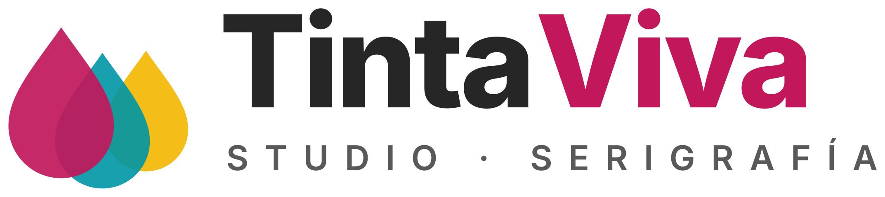

# SGE UD7 · Odoo de principio a fin

**Autor:** José Miguel Gutiérrez López · 2.º DAM · Sistemas de Gestión Empresarial

**Empresa:** TintaViva Studio S.L., un taller de serigrafía y merchandising personalizado de Sevilla.

## Vídeo

[Ver el vídeo en YouTube](https://youtu.be/NZ_JcobJXy8)

## Índice del vídeo

| Minuto | Parte |
|---|---|
| 00:00 | Presentación de TintaViva |
| 01:00 | Datos de la empresa |
| 01:50 | Catálogo de productos |
| 02:40 | Clientes |
| 03:15 | Diseño de los documentos |
| 03:50 | Usuarios y tipos de usuario |
| 06:30 | Grupo propio TintaViva / Comercial junior |
| 08:10 | Grupo propio TintaViva / Facturación de pedidos |
| 10:40 | Comprobación de permisos: Marta |
| 12:10 | Comprobación de permisos: José Miguel |
| 12:50 | Comprobación de permisos: Carmen |
| 13:30 | Usuario portal: Lucía |
| 14:20 | Presupuesto S00002 con Marta |
| 17:10 | Confirmación del pedido con José Miguel |
| 18:40 | Entrega WH/OUT/00002 y bajada de stock |
| 20:40 | Factura INV/2026/00002 y pago con Carmen |
| 23:20 | Estado final: pedido completamente facturado |