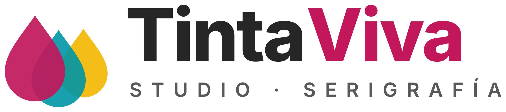

# Ficha de la empresa

## Datos de la empresa

Todos los datos son inventados.

| Dato | Valor |
|---|---|
| Nombre | TintaViva Studio S.L. |
| Sector | Serigrafía y merchandising personalizado |
| NIF | ESB00000000 |
| Dirección | Calle de la Imprenta, 12 · 41001 Sevilla · España |
| Teléfono | 955 000 000 |
| Correo | hola@tintaviva.es |
| Web | www.tintaviva.es |
| Colores corporativos | Magenta `#C2185B`, cian `#0097A7` y amarillo `#F5B700` |

## A qué se dedica

TintaViva es un pequeño taller de Sevilla que personaliza ropa y objetos con serigrafía. Trabaja sobre todo para bares, clubs, asociaciones y empresas que quieren camisetas, sudaderas o tazas con su logo, y también para particulares que buscan un regalo. Si el cliente no tiene logo, TintaViva también se lo diseña.

Los colores de la marca son los de las tintas de impresión, y por eso el logo son tres gotas de tinta.

## Catálogo

| Referencia | Producto | Tipo | Precio de venta | Coste | IVA | Stock inicial |
|---|---|---|---|---|---|---|
| TV-CAM-01 | Camiseta personalizada | Bienes, con inventario | 14,90 € | 5,20 € | 21 % | 100 |
| TV-SUD-01 | Sudadera con capucha personalizada | Bienes, con inventario | 32,00 € | 13,50 € | 21 % | 40 |
| TV-TAZ-01 | Taza de cerámica personalizada | Bienes, con inventario | 9,50 € | 2,60 € | 21 % | 60 |
| TV-DIS-01 | Diseño de logotipo | Servicio | 80,00 € | 20,00 € | 21 % | No aplica |

Los tres productos físicos tienen activado el control de inventario, así que el stock baja cuando se valida una entrega. Además se facturan por cantidades entregadas, para no facturar nada que no haya salido del almacén.

## Clientes

| Cliente | Tipo | NIF | Ciudad | Condiciones de pago |
|---|---|---|---|---|
| Cervecería Lúpulo Bravo S.L. | Empresa | ESB11111119 | Sevilla | 30 días |
| Lucía García Montes | Particular | 00000000T | Alcalá de Guadaíra | 30 días |

## Diseño de los documentos

Configuré el diseño de los documentos en Odoo con el logo, los colores de la empresa, la frase «Serigrafía y merchandising personalizado» y un pie de página con los datos de TintaViva, para que el presupuesto y la factura parezcan de un negocio real.
